# Enterprise Identity & Access Management (IAM) Lab

**Microsoft Entra ID | SAML SSO | MFA | User Management**

## Project Overview

I created this project to get hands-on experience with Identity and Access Management (IAM) and learn more about the work that IAM analysts do on a daily basis.

For this lab, I set up a fictional company called **DTS Technologies** using Microsoft Entra ID. I created eight employee accounts across four departments: HR, Finance, IT, and Sales.

Throughout the project, I practiced managing employee accounts, creating security groups, assigning application access, and setting up Single Sign-On (SSO) and multifactor authentication (MFA).

I also tested what happens when someone tries to access an application they aren't authorized to use. After that, I simulated an employee transferring departments and another employee leaving the company to practice updating and removing access.

My goal with this project was to get more comfortable using Microsoft Entra ID and better understand how companies manage employee identities and protect their applications.

## Technologies Used

- Microsoft Entra ID
- Microsoft Azure Portal
- Microsoft Entra SAML Toolkit
- SAML 2.0
- Microsoft Authenticator
- Microsoft Entra Sign-in Logs
- Microsoft Entra Audit Logs

## Lab Environment

| Component | Setup |
|---|---|
| Company | DTS Technologies (fictional) |
| Identity platform | Microsoft Entra ID Free |
| Employee accounts | 8 |
| Security groups | 4 |
| Departments | HR, Finance, IT, Sales |
| Authentication | SAML SSO and Microsoft Authenticator |

## What I Worked On

### 1. User and Group Management

- Created eight fictional employee accounts in Microsoft Entra ID.
- Added employee information such as job titles, departments, and employee IDs.
- Created separate security groups for HR, Finance, IT, and Sales.
- Assigned employees to their appropriate departmental groups.
- **Security Groups Created**

This screenshot shows the four security groups I created in Microsoft Entra ID to organize employees by department.

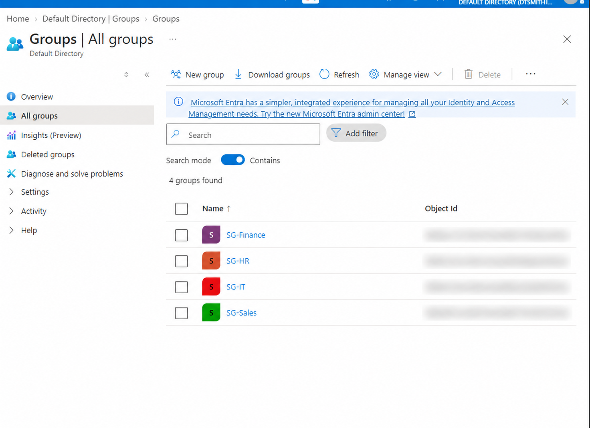

**Employee Account Creation**

This screenshot shows an employee account I created in Microsoft Entra ID. I added their job title, department, company name, and employee ID to simulate onboarding a new employee.

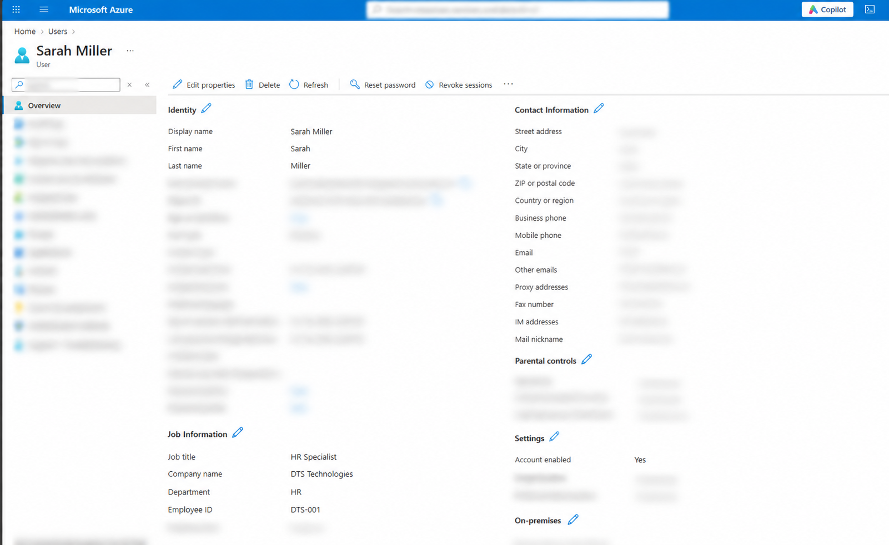

**HR Security Group Membership**

I added Sarah Miller and John Carter to the HR security group to practice organizing employees by department. This screenshot shows their original group memberships before I transferred John to Finance later in the lab.

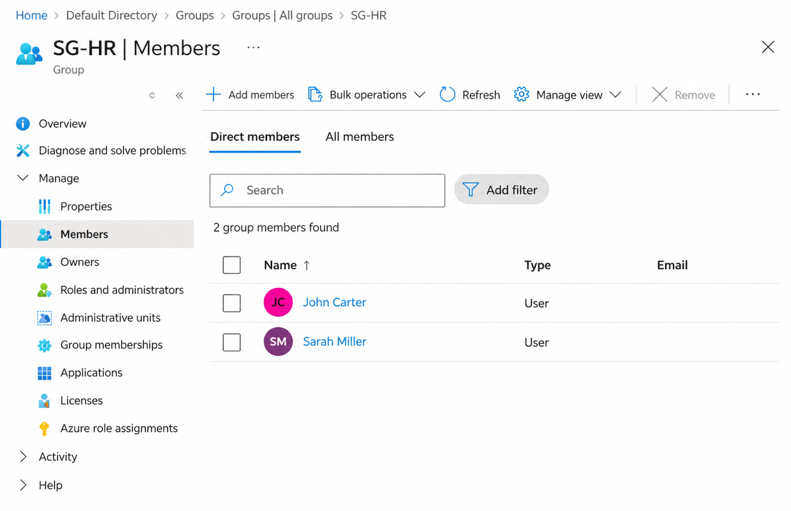

### 2. Application Access Management

- Created a test enterprise application called DTS Finance Portal.
- Assigned Finance employees to the application.
- Configured the application to require users to be assigned before signing in.

- **DTS Finance Portal — Application Assignments**

For this part of the lab, I created a test enterprise application called DTS Finance Portal to practice managing employee access.

I assigned Jaxson Dart and Pete Crow-Armstrong, two employees in the Finance department, to the application.

I also configured the application to require user assignment before sign-in. This helped me understand how IAM teams limit application access to specific employees.

The Finance Portal was used to practice application assignments. I tested working SAML SSO separately using the Microsoft Entra SAML Toolkit.

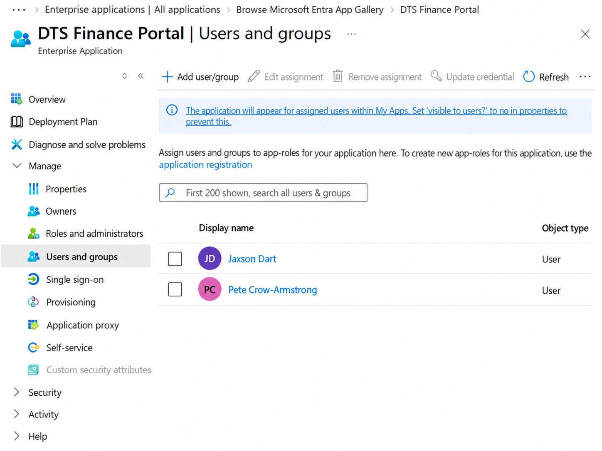

### 3. Single Sign-On (SSO) and MFA

- Set up SAML SSO using the Microsoft Entra SAML Toolkit.
- Configured the SAML URLs, signing certificate, and NameID attribute.
- Registered Microsoft Authenticator for a test employee.
- Successfully tested signing in through Microsoft Entra ID.

**SAML Single Sign-On Configuration**

I used Microsoft Entra SAML Toolkit to practice setting up Single Sign-On (SSO).

I set up the SAML settings, including the Entity ID, reply URL, sign-in URL, and NameID. I also used a signing certificate to help connect Microsoft Entra ID to the test application.

This screenshot shows my original setup. I later updated the URLs to get Single Sign-On working properly.

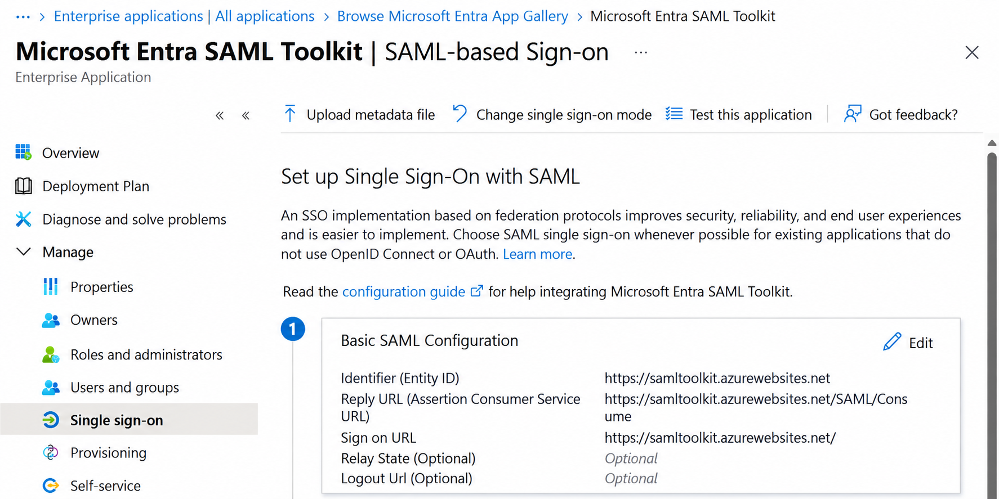

**SAML NameID Claim Configuration**

I also configured the NameID claim for the Microsoft Entra SAML Toolkit.

I configured the NameID claim in Microsoft Entra ID by setting the name identifier format to Email address and selecting user.userprincipalname as the source attribute. This helped me understand how Microsoft Entra ID sends user identity information to an application during SAML SSO.

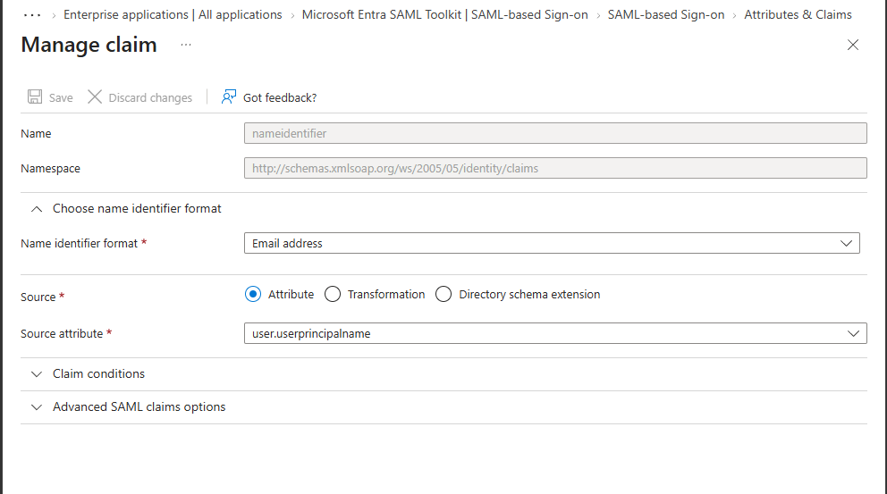

**Multifactor Authentication (MFA)**

I set up Microsoft Authenticator for Jaxson Dart's test account to get some hands-on practice with MFA in Microsoft Entra ID.

The screenshot shows that Microsoft Authenticator was added to the account and set as the default sign-in method. This helped me understand how MFA makes accounts more secure by adding another step besides just entering a password.

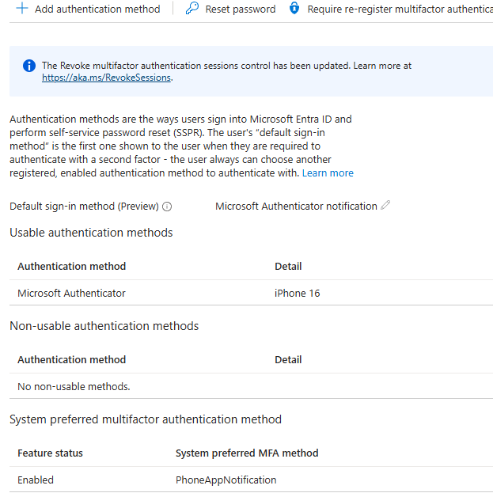

**Successful SSO Sign-In**

I tested signing in to the Microsoft Entra SAML Toolkit using Jaxson Dart's test account.

I checked the sign-in logs in Microsoft Entra ID and saw that the sign-in was successful. The logs also showed that the MFA requirement was already satisfied by a claim in the token.

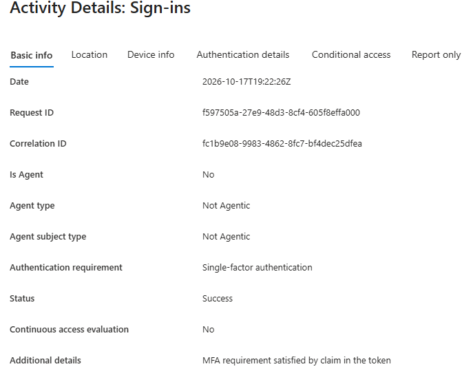

### 4. Access Control Testing

- Tested signing in with an employee who was assigned to the SAML Toolkit.
- Attempted to sign in with an employee who wasn't assigned.
- Confirmed Microsoft Entra blocked the unassigned employee with error **AADSTS50105**.
- Reviewed sign-in logs to verify the authentication results.

**Testing Unauthorized Access**

I wanted to see what would happen if someone tried signing into an application they weren't supposed to have access to.

I used Sarah Miller's account to test this because she wasn't assigned to the Microsoft Entra SAML Toolkit.

When I tried signing in, Microsoft Entra ID blocked her access and showed error **AADSTS50105**.

This helped me understand how companies can use application assignments to control who can access certain applications.

**Unauthorized Access Test Screenshot**

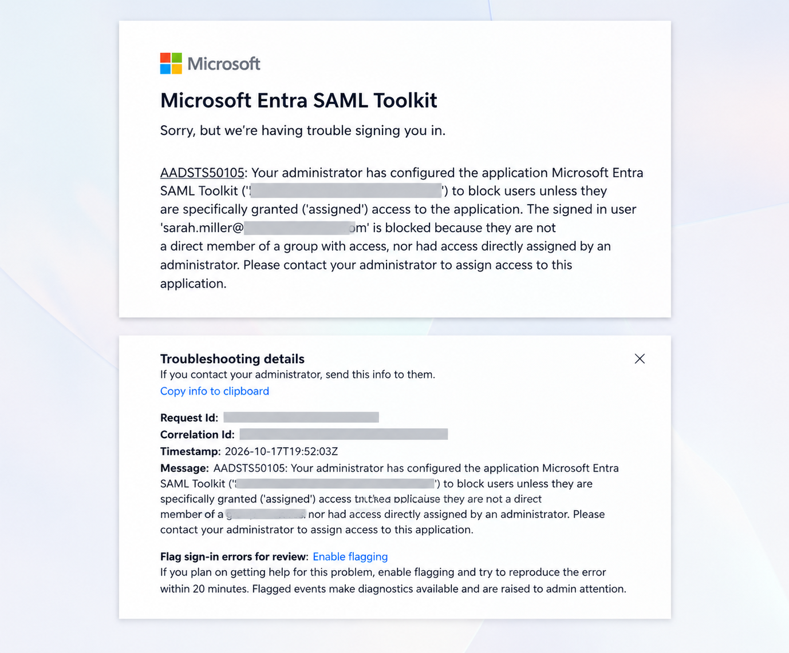

### 5. Employee Lifecycle Management

- Simulated an employee transferring from HR to Finance.
- Updated their department, job title, and security group memberships.
- Simulated an employee leaving the company.
- Disabled their account, revoked sign-in sessions, and removed group access.
- Reviewed audit logs to confirm the changes were recorded.

**Employee Department Transfer (John Carter)**

For this part of the lab, I practiced updating an employee's account when they move to a different department.

I used John Carter as my example. He originally worked in HR as an HR Coordinator, but I transferred him to Finance and changed his job title to Financial Analyst.

I also removed him from the HR security group and added him to the Finance security group so his access matched his new position.

This helped me understand why companies need to keep employee information and permissions updated when someone changes roles.

**Before the Transfer**

This screenshot shows John's original job information when he worked in HR.

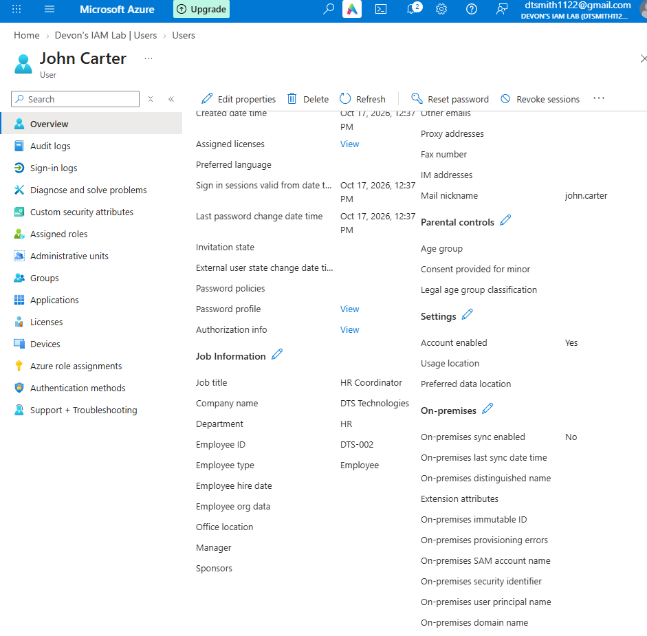

**After the Transfer**

This screenshot shows John's updated information after I moved him to Finance.

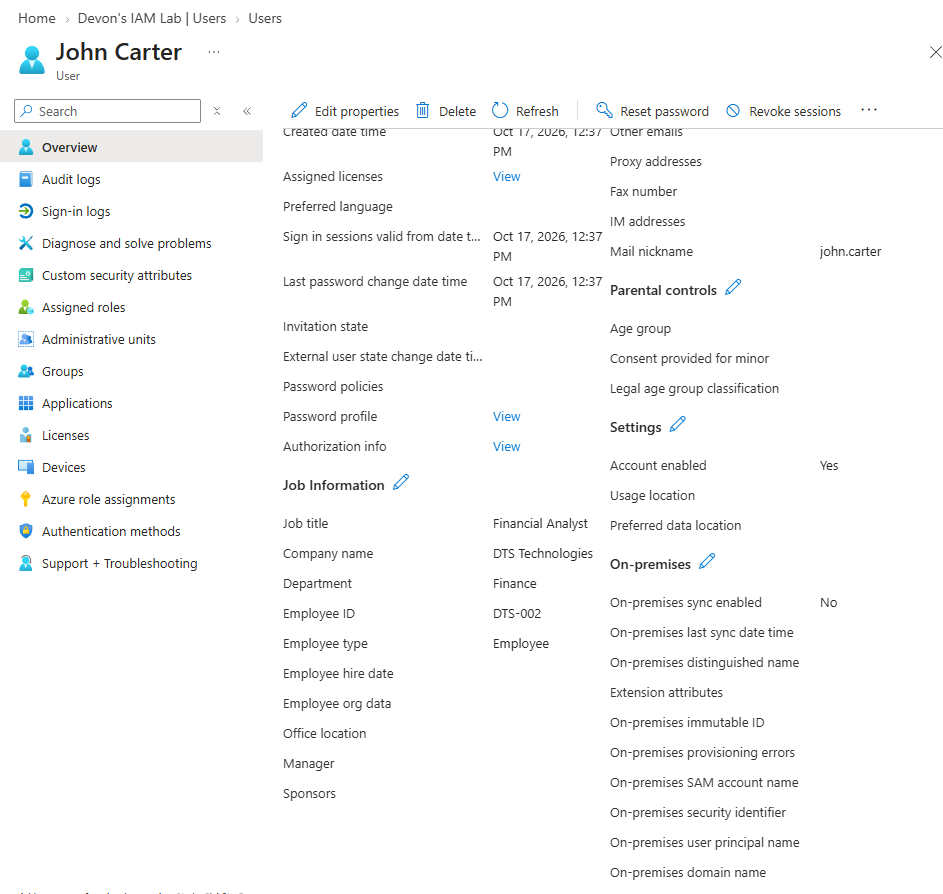

## What I Learned

This project helped me better understand how IAM works beyond just learning the concepts in class.

I got experience working directly in Microsoft Entra ID and saw how user accounts, security groups, application assignments, and authentication all work together.

One of the most useful parts was testing SAML SSO and seeing the difference between a user successfully signing in and another user being denied access because they didn't have permission.

I also learned why it's important to remove old access when employees change roles or leave a company.

Overall, this lab gave me a better understanding of the responsibilities of an IAM analyst and helped me build practical skills I can continue developing in future projects.

---

*This is a personal learning project. DTS Technologies and its employee accounts are fictional.*
